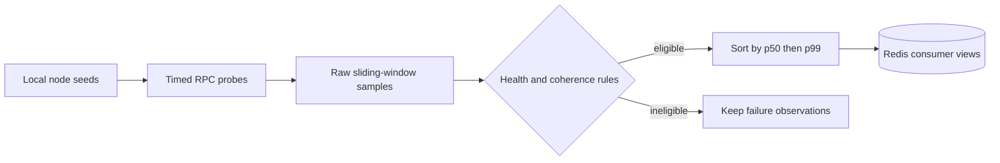

# RPC Health Monitor

  

Measure RPC endpoint latency and chain coherence, then publish per-network rankings to Redis for downstream consumers.

The monitor targets Ethereum, BSC and Base. It times `eth_blockNumber` probes, keeps raw timestamped samples in a sliding window and ranks eligible nodes by median latency with tail-latency tie-breaking.

## What “healthy” means here

[monitor.py](monitor.py) evaluates more than HTTP success: success rate, block lag, syncing state and coherence with the network's observed height affect eligibility. Metadata checks distinguish client, transport and capabilities. Latency summaries include nearest-rank `p50`, `p90`, `p95` and `p99`, plus sample count/min/max/mean.

## Redis output contract

| Key | Content |
| --- | --- |
| `rpc:rank:{net}` | Sorted set scored by median latency. |
| `rpc:node:{net}:{endpoint}` | Detailed node/configuration JSON. |
| `rpc:best:{net}` | Selected top endpoints. |
| `rpc:meta:{net}` | Publication timestamp and healthy/total counts. |

[exemplo_consumo.py](exemplo_consumo.py) shows the consumer side; [dashboard.py](dashboard.py) provides local inspection.

## Node inventory privacy

[data/nodes_resultado.json](data/nodes_resultado.json) contains exactly three **fictional examples**, using the documentation-only address blocks defined in [RFC 5737](https://www.rfc-editor.org/rfc/rfc5737.html). They are not working RPC providers or measured results.

Keep real inventories under ignored `data/private/` and select them with `NODES_FILE` (for example `/data/private/nodes_resultado.json` inside the Compose container). Use `SEED_FALLBACK` for a separately configured private text seed. Never publish populated node inventories.

## Operator inputs

`NODES_FILE` selects the seed file; `TARGET_NETS`, `PROBE_INTERVAL`, `CONCURRENCY`, `TIMEOUT`, `WINDOW`, `RANK_WINDOW_SEC`, `MIN_WINDOW_SEC`, `MIN_SUCCESS` and `MAX_LAG` control collection/ranking. `REDIS_URL` selects shared state. Review [.env.example](.env.example) and [docker-compose.yml](docker-compose.yml) before running the monitor.

A local source check is `python -m py_compile monitor.py dashboard.py exemplo_consumo.py`; the runtime requires aiohttp, websockets and the Redis client declared by the project. No dedicated offline behavior suite is bundled. A high rank is a measurement under the configured workload/window, not a guarantee of archival coverage or transaction-delivery performance.

**Technology:** Python · aiohttp · websockets · Redis · Docker

Project-authored source: [MIT](LICENSE). Third-party components retain their own notices and terms.
