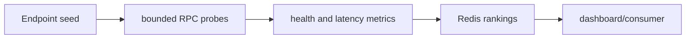

# RPC Health Monitor

**Measure endpoint health, chain coherence and latency for ranked selection.**

  [](LICENSE)

[Overview](#overview) · [Quickstart](#quickstart) · [Example](#example) · [Validation](#validation) · [Documentation](#documentation)

## Overview

A read-only RPC endpoint monitor that measures latency and chain coherence and publishes ranked endpoints.

**Stack:** Python · aiohttp · websockets · Redis · Docker

## Health is more than HTTP success

| Component | Behavior |
| --- | --- |
| Identity | Probes compare chain identity and synchronization. |
| Freshness | Block observations and coherence checks help identify lagging nodes. |
| Ranking | Latency samples and health results feed Redis rankings and consumers. |

## Processing path



## Quickstart

```console
python -m venv .venv
# Activate .venv, then:
python -m pip install -r requirements.txt
python -m py_compile monitor.py auditoria.py dashboard.py exemplo_consumo.py
```

The commands above install prerequisites or run the specified offline checks. Live collection, cloud operations, messaging and trading are separate operational steps when present.

## Example

**Inspect the workflow**

Supply your own endpoint seed through `NODES_FILE`. Follow a probe into its health/latency sample and network ranking, then inspect the consumer example. A reachable endpoint is not automatically an archive provider or a working WebSocket endpoint.

## Configuration and storage

[.env.example](.env.example) documents Redis, probe cadence, concurrency, timeout, minimum samples, maximum lag and ranking windows. Candidate endpoints and Redis connectivity are external dependencies.

## Repository guide

| Location | Responsibility |
| --- | --- |
| [monitor.py](monitor.py) | Probe and ranking loop |
| [auditoria.py](auditoria.py) | RPC audit helpers |
| [dashboard.py](dashboard.py) | Status interface |
| [exemplo_consumo.py](exemplo_consumo.py) | Rank consumer example |

## Validation

The quickstart lists the declared checks. No passing CI or coverage claim is implied by the technology badges.

## Scope and operational boundaries

The syntax quickstart makes no RPC calls. Current endpoint availability, archive support and rate limits need live provider verification. A ranking is bounded by its sampling window and freshness.

## Documentation

- The repository guide above links directly to the implementation and configuration files.

## License and attribution

Project-authored source code is licensed under the [MIT License](LICENSE). Third-party components and datasets retain their respective rights and licenses.
